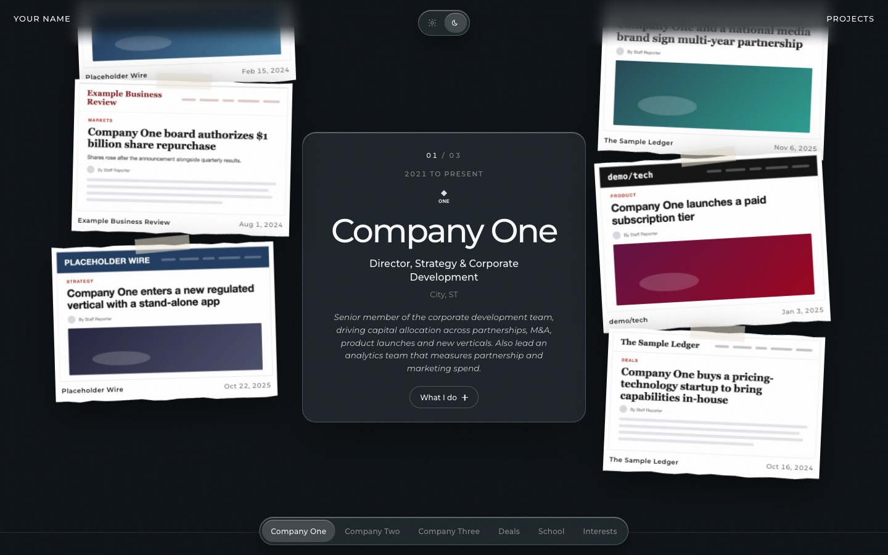
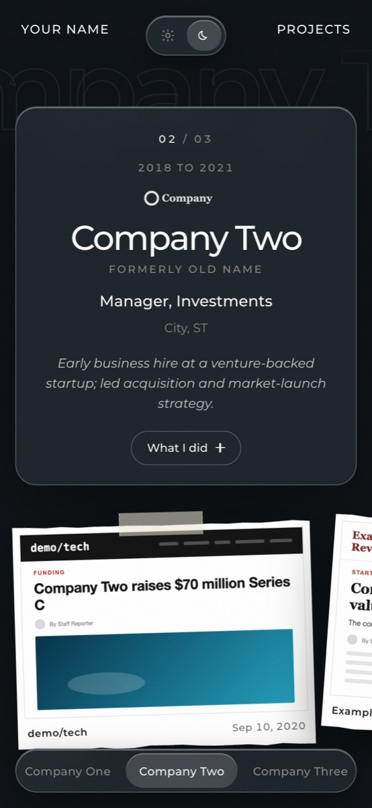
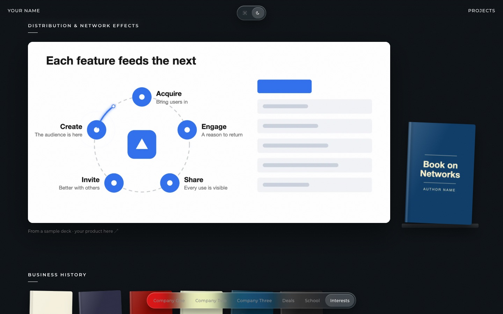

# Resume site

A one-page resume that reads like a scrapbook. Each role sits in the centre, with press clippings about that job taped on either side. Deals, school and interests follow, and the page ends on a sticker that opens an email.

It's plain HTML, CSS and JavaScript, with no build step and no dependencies apart from one Google Font. Everything here is placeholder content: the companies, outlets, clippings, photos, schools and books are all made up.



| Phone | Interests |
| --- | --- |
|  |  |

## What it does

- **Roles**: years, a monochrome logo, title, location and a one-line description. Tapping a card opens its bullets. The card stays centred while the clippings scroll past with a little parallax.
- **Clippings**: screenshots on torn paper with tape. Each one links to its article. On phones they turn into a swipe rail with a counter and a progress bar.
- **Deals**: headers that open to their bullets.
- **Interests**: polaroid clusters and a photo viewer. Opening a photo grows it from its thumbnail and fits it to the screen. You can move between photos with arrows, the keyboard or a swipe; swipe down to close.
- **Slide**: one deck slide, with an orbit that runs round its ring and pings each node as it passes.
- **Bookshelves** with covers that link out.
- **Light and dark themes**, stored in `localStorage.theme`, plus a bottom dock that tracks the section you're in. It honours `prefers-reduced-motion`.

## Make it yours

Everything lives in `site/resume/`.

| What | Where |
| --- | --- |
| Name, roles, bullets, deals, school, interest labels, captions | `index.html` |
| Clippings (`CLIPS`), the hero ticker (`TICKER`), books (`BOOKS`) | top of `resume.js` |
| Clipping screenshots, 1000px wide WebP | `img/press/` (add the pixel height to `CLIPS` too) |
| Photos, covers, logos, slide, sticker | `img/`, `img/books/`, `img/logos/` |
| Downloadable resume | `Resume.pdf` |
| Colours, spacing, type | tokens at the top of `resume.css`; the shared ones are in `site/helix.css` |

Notes:

- Company logos are painted with a CSS mask in the theme's ink colour. A black-on-transparent SVG works best. Set its size on `.role-logo-*` in `resume.css`.
- The orbit is drawn in the slide's own coordinates (`viewBox="0 0 2400 1200"`). If you swap the slide, set the ring's centre and radius in `index.html` (`.orbit-trail`) and in `resume.js` (`cx`, `cy`, `r`).
- Bump the `?v=` on `resume.css` and `resume.js` whenever you change them, so browsers pick up the new files.

## Run it

```sh
python3 -m http.server 8000 -d site
```

Then open <http://localhost:8000/resume/>. The page uses root-relative paths, so serve `site/` as the web root.

## Deploy

Any static host will do. On Cloudflare Pages:

```sh
npx wrangler pages deploy site --project-name <your-project>
```

`site/_headers` makes the page revalidate on every load and caches images for a day.
